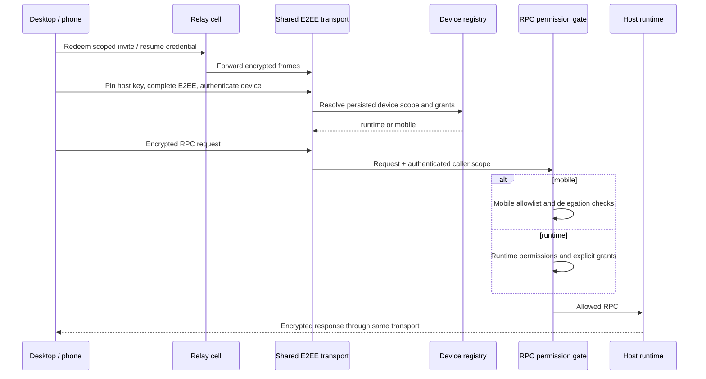

# Relay in the Orca fork

`selfhost-relay` is rebased onto upstream main at
[`398cb846f`](https://github.com/stablyai/orca/commit/398cb846ff16a5abfb9350309842c16a3fe8148a).
Release **v1.4.224-relay.2** builds the server, desktop renderer, preload, CLI,
web client and mobile web bundle from this fork. Desktop runtime Relay support is
adapted from [upstream PR #25492](https://github.com/stablyai/orca/pull/25492),
including the newer upstream permission and delegated-phone model.

## Shared transport, separate permissions

Relay invite creation, host registration, E2EE v2 framing, device authentication,
resume credentials and revocation are shared. Relay is a transport: it never
changes a device's persisted scope or grants.

| Client                       | Invite                                                | Permissions                                                                                  |
| ---------------------------- | ----------------------------------------------------- | -------------------------------------------------------------------------------------------- |
| Orca desktop                 | `scope=runtime`, `orca serve --relay`                 | Upstream paired-runtime permissions; no pairing administration or desktop control by default |
| Phone                        | `scope=mobile`, `orca serve --relay --mobile-pairing` | Existing mobile RPC allowlist and delegated-phone restrictions                               |
| Runtime with desktop control | Explicit `--grant-desktop-control` at pairing         | Adds only the upstream desktop-control grant                                                 |

The dispatcher grants a Relay-enabled runtime connection access to exactly two
self-management calls: `pairing.getEndpoints` and `pairing.provisionRelay`. Both
require the authenticated E2EE device identity and operate on that device only.
Other pairing administration remains denied. An ordinary direct runtime device
cannot obtain Relay eligibility by calling those methods. Failed cloud credential
installation does not turn an expiring invite into persistent Relay demand.

Runtime access includes executing workspace commands as the host user, as upstream
does. These RPC distinctions are not an OS sandbox.



The desktop client stores the private Relay route with the existing runtime host.
It tries direct E2EE first, then Relay; subsequent calls use the same request and
subscription interfaces. Resume credentials refresh in place, and removing a
runtime grant revokes its Relay credential and delegated children. Public host
summaries omit Relay bearer credentials.

## Use from the desktop or CLI

Install this fork on the connecting desktop as well as the server. An older
official desktop does not implement the new Relay route.

On a signed-in host, **Settings → Remote Orca Servers → Share this host → Any network**
creates a runtime Relay link. On the other desktop, paste it into **Add server**.
Mobile links remain separate and are added in the phone app.

```sh
# Desktop/runtime invitation
orca serve --relay --port 6768 --json
# Phone invitation (choose this mode instead when starting the server)
orca serve --relay --mobile-pairing --port 6768 --json
```

`--relay` selects the Relay-capable Electron host; the current upstream `orcad`
serve host has no account-backed Relay provider. A failed runtime Relay mint is
reported separately from direct pairing, so a direct link is never presented as a
working Relay link. `--no-pairing` suppresses direct invitation creation and cannot
be combined with `--relay`.

For runtime JSON output, use `pairing.relay.url` when `pairing.relay.available` is
true. `pairing.url` is the separate direct link. The private `ORCA_PAIRING_FILE`
contains the underlying offer: runtime Relay is also `pairing.relay.url`; mobile
Relay is `pairing.pairingUrl`. Treat all these URLs as credentials.

Standalone browser clients and the external CLI do not gain their own Relay
connector in this change. The desktop's remote-runtime transport implements it.

## Linux installation

Download the versioned installer or `.deb` from the
[release](https://github.com/ocss884/orca/releases/tag/v1.4.224-relay.2).
The installer supports Debian/Ubuntu amd64 and arm64, including systemd-enabled
WSL2, and verifies `SHA256SUMS`, package version and architecture before install.

```sh
curl -fL https://raw.githubusercontent.com/ocss884/orca/v1.4.224-relay.2/config/scripts/install-selfhost-relay.sh -o /tmp/install-orca-relay.sh
sudo bash /tmp/install-orca-relay.sh

# Configure your existing compatible Relay and start the runtime-scoped server.
sudo bash /tmp/install-orca-relay.sh \
  --user "$USER" \
  --relay https://relay.example.com:8443 \
  --password-file /path/to/private/relay-password \
  --ca /path/to/relay-ca.crt
# Add --scope mobile to generate a phone invitation instead.
```

Omit `--ca` for a publicly trusted certificate. The password stays in a private
file, never in argv. TLS verification remains enabled. The Relay deployment and
single-user compatible authentication service are external to this repository.
The login helper uses their PKCE desktop authorization/session endpoints; it is
not a substitute for the official hosted service's interactive account login.

All application paths and identity follow upstream:

- Application: `/opt/Orca`; CLI and package identity remain Orca's.
- Profile and configuration: the service user's `~/.config/orca`.
- Service: `orca.service`; environment: `~/.config/orca/relay.env`.
- Private files: `relay-password`, `relay-session.json`, `pairing.json` in that profile.
- An explicit `--data-dir /absolute/path` is passed through the official profile override.

No `.orca-selfhost`, separate package identity or fork-only default data root is
created. Do not run two hosts on the same profile. The service runs with the chosen
user's ordinary file/process privileges. Configure AI CLI installations and `PATH`
for that account. Root uses Electron's required `--no-sandbox`; prefer the account
that normally owns your projects.

Each service start refreshes the origin-bound login session. A running host uses
Orca's regular refresh logic. Import rejects expired or wrong-origin sessions,
missing Relay entitlement, unsafe permissions and replacement of another account.

```sh
sudo systemctl status orca.service
sudo systemctl kill --kill-who=main --signal=SIGUSR2 orca.service
```

SIGUSR2 writes a fresh private invitation without restarting the runtime. The unit
discards readiness stdout because it contains credentials. Logs are in the journal.
`--pairing-address 127.0.0.1` advertises loopback; it does not change the bind address.
Restrict inbound port 6768 separately if only outbound HTTPS/WSS Relay is desired.
The wrapper uses the native transport inside Orca, without an external proxy process.

## Upgrade an older fork installation

The earlier release used `orca-selfhost.service` and separate paths. The new
installer refuses while that old service is active. Publishing a release does not
upgrade a running host automatically.

1. Stop the old service and back up its profile, config and program. Preserve E2EE
   keys and the device registry together; they determine existing-device identity.
2. With both hosts stopped, move the old profile to the official `~/.config/orca`
   only if that destination does not already contain another Orca profile. Do not
   merge two profiles. Alternatively, use `--data-dir` explicitly to keep the old
   profile at its current path.
3. Install/configure the new release with the desired user, Relay origin and private
   password/CA files. It writes a new `relay.env` in the selected profile. The old
   `ORCA_SELFHOST_*` environment names remain input aliases for manual installations.
4. Verify desktop and phone reconnect, then disable the old service. Never start
   both against the same profile or port. Retain the old backup until accepted.

Rollback requires stopping the new service and restoring the matching old profile
snapshot as well as its binary. Use manual fork releases for upgrades; macOS ZIPs
are ad-hoc signed and not notarized, so they do not provide official signed updater
compatibility. Gatekeeper may require explicitly approving the downloaded app.

## Reproduce and verify the release

Use Node 24 and the pinned pnpm from `package.json`:

```sh
pnpm install --frozen-lockfile
(cd mobile && pnpm install --frozen-lockfile)
ORCA_BACKGROUND_LAUNCH=1 pnpm tc
pnpm test:selfhost-relay
python3 config/scripts/selfhost-relay-install.test.py
pnpm build:release
python3 config/scripts/prepare-relay-release.py --template /path/to/orca-ssh-template-57452c681f27.zip
pnpm exec electron-builder --config config/electron-builder.relay.cjs --linux deb --x64 --publish never
```

The release workflow builds Linux amd64, Linux arm64 and macOS arm64 natively. All
Orca application JavaScript is rebuilt from the fork. The separate cross-platform
SSH deployment template is pinned to upstream commit
`57452c681f27c03fd3c016a06da6315777db775a` and SHA-256
`915b2ca129fccc0f4d7e94d78f7027580d123db13e58782bc3d9c7d86b9d7ce9`.
The exact input ZIP is included in the fork release. Upstream's nine-target template
and Linux glibc compatibility guards run during packaging without bypasses.

`resources/BUILD-INFO.json` records the fork commit, upstream base, native-template
commit and hashes of the application and Relay helpers. Tests exercise runtime and
mobile authentication, scope/grant rejection, direct fallback, cloud relocation,
credential renewal/revocation, delegated phones, headless session import and UI link
handling. These automated peers are not a claim of physical iPhone acceptance.
